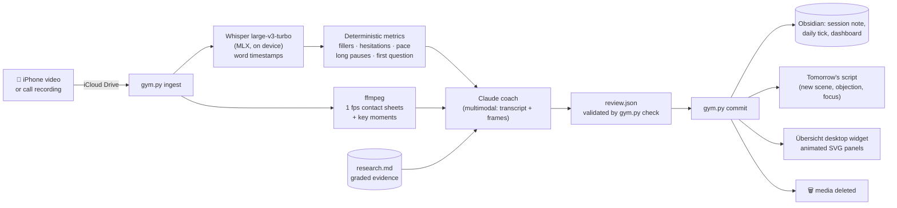

# Sales Gym — an AI sales coach that watches you practise

> Record yourself on your phone, drop the video in iCloud, and within minutes an AI coach has transcribed it, measured your filler words, hesitations and pace, looked at your body language frame by frame, graded you on 5 skills, given you 3 research-backed tips, and written **tomorrow's training script**, a new one every day and tuned to your weakest point. Your progress then shows up live on your Mac desktop.

<p>
  
  
  
</p>
<p>
  
  
  
</p>

*Real panels from my desktop. They are animated SVGs, rendered by `render.py` and shown by an Übersicht widget and in Obsidian.*

## Why
I sell an AI receptionist to doctors (see [Lead Medici Generation](https://github.com/RiccardoFalco06/lead-medici-generation)), and the bottleneck after lead generation was **me on the phone**. My first real call had the usual problems: filling silence with filler words, pitching before asking, ending without a date. So I built myself a gym.

**First results, two real calls on the same day:**

| | Call 1 (baseline) | Call 2 | |
|---|---|---|---|
| Filler words / min | 9.8 | **5.4** | **−45%** |
| Hesitations / min | 9.1 | **6.3** | −31% |
| Time to first real question | 57 s | **14 s** | **4× faster** |
| Overall score | 6/10 | **7/10** | |

## How it works



### Signal processing, not vibes
- **Transcription on device** with Whisper large-v3-turbo on Apple Silicon (MLX). An `initial_prompt` stops Whisper from cleaning up the speech and deleting the filler words we need to count.
- **Hesitations are found in the audio, not only in the text.** Whisper stretches words over hesitations, so `gym.py` puts word timing together with an **RMS loudness curve** (50 ms frames, adaptive voiced threshold) to spot sounds that are held too long.
- **Pace counts speaking time only** (pauses excluded), plus count of long pauses and **seconds to the first real question**.
- **Real calls:** the agent first labels which segments are the client speaking, then the metrics are **recomputed on my turns only**.

### AI coach with guardrails
- The Claude agent gets the metrics and **may not recompute or contradict them**. It adds what code can't measure: logical flow, presence (eye contact, posture, gestures from the frames) and handling of objections.
- **5 sub-scores** (logical flow, fluency, presence, confidence, conversation) and an overall score, strict but fair.
- **Evidence-graded advice:** tips come from `research.md`, a running bibliography in which every source is rated (*strong / medium / weak*). On Mondays the coach searches for new studies and adds them. It never invents sources.
- **Prompt-injection safe:** the transcript is treated as data to evaluate, never as instructions.
- **Schema-validated output:** `gym.py check` rejects any review that breaks the rules (script too long, identical to recent ones, missing fields) until it passes.

### Spaced, adaptive training
- **A new script every day:** different scene, kind of doctor, questions, objection and focus. It must not repeat any recent script.
- **4 difficulty levels** that rise with your history: full script → headings only + a new objection → sceptical doctor → price and closing.
- **One focus at a time**, picked from the data. After a real call it restarts from the mistakes made in that call.
- The script **only changes after a session**. Skip a day and it waits for you. A daily reminder email goes out from 7 am.
- Habit design draws on ADHD-friendly ideas (if-then plans, immediate feedback, streaks), used as inspiration only.

### Fully automatic
- launchd runs `gym.sh` every 10 minutes with a lock, a stale-lock cleanup and daily logs. It picks up new files in iCloud, files real calls (`Chiamate/`) apart from practice runs, and puts aside recordings with too little speech.
- It also works from chat: the `skill/` folder is a Claude Code skill. Send a video in chat and you get the same analysis.
- **Private by default:** everything runs on the Mac, and once analysed the media files are **deleted**.

## Repo layout
| File | Role |
|---|---|
| `gym.py` | CLI: `ingest`, `metrics`, `check`, `commit`, `render`, `auto`, `today` (pure metric functions + pipeline) |
| `render.py` | animated SVG dashboard panels (streak calendar, weekly score, 5 areas, fillers, pace, last session) |
| `prompt.md` | coach instructions |
| `research.md` | evidence base with graded sources |
| `test_gym.py` | tests for the metrics, validation and full pipeline |
| `gym.sh` | launchd entry point |
| `widget/` | Übersicht desktop widget |
| `skill/` | Claude Code skill for analysis from chat |

## Run it yourself
Requirements: macOS on Apple Silicon, Python 3.11+, `ffmpeg`, [Claude Code](https://claude.com/claude-code).

```bash
pip install -r requirements.txt
export GYM_EMAIL=you@example.com GYM_VAULT="$HOME/path/to/vault/Sales Gym"
python3 test_gym.py                       # prints "ok"
python3 gym.py today                      # today's note + script
python3 gym.py ingest my_practice.mov     # ⚠ the file is deleted after commit
cp -r widget ~/Library/Application\ Support/Übersicht/widgets/sales-gym.widget
```
The prompts and coaching are in Italian (my sales market); the pipeline itself works in any language.
